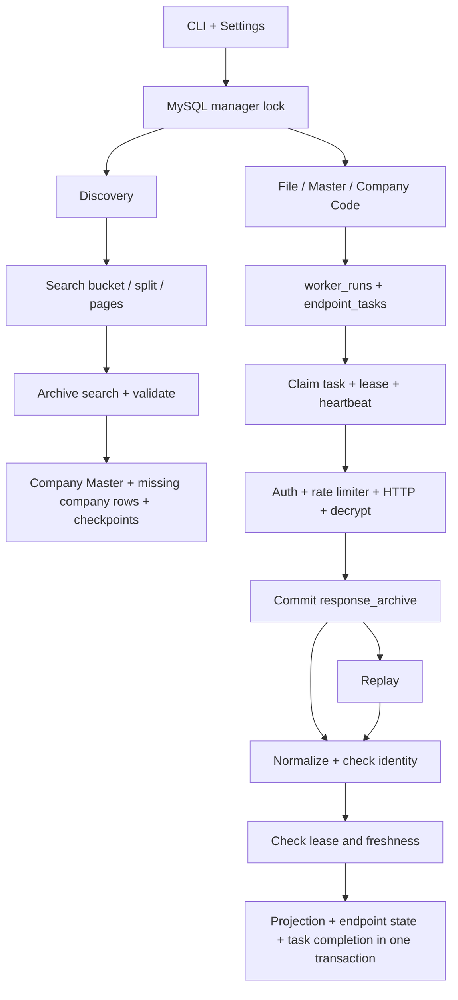

# แผนที่ระบบและผลตรวจโครงการ DBD

ตรวจเมื่อ 2026-09-15 จาก checkout ปัจจุบัน เอกสารนี้แยกพฤติกรรมที่อ่านได้จากโค้ด ผลที่ทดสอบแล้ว และความเสี่ยงที่ต้องพิสูจน์เพิ่มเติม

## 1. ระบบนี้ทำอะไร

Python CLI สำหรับเก็บข้อมูล DBD DataWarehouse ลง MySQL ประกอบด้วยการค้นหาบริษัท การดึงรายละเอียดและงบการเงิน การเก็บหลักฐานดิบ และการกลับมาทำงานต่อหลังหยุด ไม่มีเว็บแอปหรือ HTTP API สำหรับผู้ใช้ใน production package; HTTP server ที่มีคือ metrics บน localhost

จุดเริ่มต้นคือ `dbd-data` ใน `pyproject.toml` → `src/dbd/cli/main.py`; `python -m dbd` ใช้ CLI เดียวกัน ระบบใหม่ใช้ endpoint task ส่วนระบบ legacy ใช้ company task ซึ่งมีตารางและ run ID คนละชุด

## 2. โครงสร้างและความรับผิดชอบ

| ตำแหน่ง | หน้าที่ |
| --- | --- |
| `src/dbd/cli/main.py` | parse/validate arguments, dispatch คำสั่ง, ครอบ manager lock, exit code |
| `src/dbd/cli/legacy.py` | คำสั่งเก่าและ helper ที่ discovery/status ยังเรียกใช้ |
| `src/dbd/core/settings.py` | Pydantic settings, อ่าน `.env` จาก checkout หรือ `DBD_ENV_FILE`, environment override |
| `src/dbd/core/exceptions.py` | ประเภทความผิดพลาดของ auth, HTTP และ contract |
| `src/dbd/core/telemetry.py` | structured logs และ Prometheus counters/gauge/histogram |
| `src/dbd/client/session.py` | curl session, warm-up, cookie fallback |
| `src/dbd/client/auth.py` | ขอและ cache token, อ่าน expiry, retry auth แบบจำกัด |
| `src/dbd/client/crypto.py` | JWT payload, HKDF/AES-GCM, decompress, Decimal JSON |
| `src/dbd/client/async_client.py` | async HTTP, semaphore, shared token refresh, retry/status classification |
| `src/dbd/client/rate_limit.py` | เว้นระยะ request, shared cooldown, ลด rate เมื่อถูกจำกัด |
| `src/dbd/client/client.py` | synchronous client สำหรับ legacy |
| `src/dbd/client/endpoints/` | สร้าง URL/parameters สำหรับ company, financial และ search |
| `src/dbd/contracts/` | ตรวจ identity/shape และแปลง JSON เป็นข้อมูลสำหรับบันทึก |
| `src/dbd/runtime/resources.py` | กลุ่ม endpoint, default selection, prerequisite และ normalizer dispatch |
| `src/dbd/runtime/worker.py` | streaming import, scheduling, consumers, heartbeat, shutdown |
| `src/dbd/runtime/replay.py` | นำ archived payload กลับมาประมวลผลโดยไม่เรียก API |
| `src/dbd/runtime/locking.py` | MySQL connection-scoped manager lock |
| `src/dbd/pipelines/discovery.py` | seed, split bucket, count, drain pages, coverage summaries |
| `src/dbd/pipelines/{bulk,company_profile,company_details,financials}.py` | synchronous compatibility pipelines |
| `src/dbd/storage/mysql/` | connection pools, transaction binding, migrations |
| `src/dbd/storage/mysql/repositories/` | queue, archive, discovery และ projection SQL |
| `sql/001..007` และ `alembic/versions/` | schema และ migration adoption/indexes |
| `sql/reports/data_inventory.sql` | SQL สำรวจข้อมูล |
| `scripts/bootstrap.ps1`, `install-command.ps1` | ติดตั้ง venv/dependencies และ CLI ลง user PATH |
| `scripts/apply_migrations.py` | compatibility entrypoint สำหรับ migration |
| `scripts/reset_discovery.py` | dry run/ล้าง discovery bookkeeping |
| `scripts/benchmark_queue.py` | synthetic queue benchmark บนฐาน `dbd_test_*` |
| `scripts/dbd_test.py`, `dbd_master_reference.py`, `probe_seed_strategy.py` | เครื่องมือทดลองและ reference ไม่ใช่เส้นทาง worker หลัก |
| `tests/` | unit tests และ integration tests ที่ใช้ MySQL + fake upstream |
| `docs/` | architecture, runbook, operations, historical validation และ roadmap |

## 3. กระบวนการตั้งแต่ต้นจนจบ



### Discovery

1. รับ keyword จาก CLI/ไฟล์ หรือสร้าง prefix seed จากรายการจังหวัดเมื่อไม่มีงาน pending
2. `SearchFilters` สร้าง body ของ POST `/api/v1/company-profiles/infos`
3. ขอหน้า 1 เพื่ออ่านจำนวนทั้งหมด; ค่าขีดจำกัดในโค้ดคือ 10 แถว/หน้า และ 1,000 หน้า/query
4. ถ้าเกิน 10,000 แถว แบ่งตามประเภทนิติบุคคล → จังหวัด → ขนาดธุรกิจ; ถ้าหมดมิติแล้วยังเกินให้ failed
5. อ่านเฉพาะหน้าที่ยังไม่มี checkpoint done โดยทำพร้อมกันเป็นกลุ่ม
6. เก็บ decoded payload ก่อน normalize; projection ของหน้าและ checkpoint commit พร้อมกัน
7. เพิ่ม master/sightings และเพิ่ม `companies` เฉพาะแถวที่ยังไม่มี ไม่ overwrite profile เดิม
8. retry หน้าที่ล้มเหลวได้; `discover-refresh` ล้าง checkpoint ของ pass เพื่ออ่านใหม่

จำนวนหน้า done ไม่ใช่หลักฐานว่าครบทุกบริษัท: ข้อมูล upstream อาจเปลี่ยนระหว่าง pagination, seeds ซ้อนทับกัน และตรวจ prefix ได้เฉพาะบริษัทที่เคยพบ

### Fetch/Bulk

1. สร้าง run สถานะ `building` พร้อม parts และ fiscal year
2. อ่านไฟล์เป็น batch หรือเดิน master ด้วย company ID; dedupe ใน MySQL
3. `bulk --master` โดยปริยายเลือกสถานะ `1` จาก `companies`; `--all-statuses` ยกเลิกตัวกรองสถานะ แต่ยังไม่รวม identity ที่เป็น conflict
4. เปลี่ยน run เป็น `ready` หลัง import จบ; import ขาดกลางทางต้องสร้าง run ใหม่
5. claim task ผ่าน `FOR UPDATE SKIP LOCKED`; เพิ่ม attempts และ lease version
6. financial tasks รอ profile done แม้ระบุปีเอง; ถ้าไม่ระบุปีเลือกค่าสูงสุดจาก `submit_fin_year`
7. ไม่มีปี → `not_available`; benchmark ที่ query ว่ามีแล้ว → `not_available` พร้อม reason
8. เรียก API และเก็บ archive ใน async transaction แยกก่อนแปลงข้อมูล
9. ส่ง projection เข้า bounded thread pool; ตรวจ lease และ identity แล้วเขียนข้อมูลพร้อม acknowledge ใน transaction เดียว
10. ความผิดพลาดบางประเภทจบเป็น failed ทันที; ส่วน retryable ใช้ retry_wait และ backoff
11. Ctrl+C คืน lease ของ process; process ตายให้ maintenance กู้ lease ที่หมดอายุเมื่อมี worker ทำงานอีกครั้ง

`--limit` นับ endpoint attempts ไม่ใช่บริษัท และ refresh ใหม่เป็น run ใหม่ ไม่ dedupe ข้าม run

### รายการ endpoint

| กลุ่ม | Endpoint | ปริยาย |
| --- | --- | --- |
| profile | profile | ใช่ |
| details | committees, committee_signs, transformations | ใช่ |
| financials | financial_submissions, financial_statements, industry_benchmark | ใช่ |
| nationality | nations, nation_history | ไม่ |
| history | name_history, capital_history | ไม่ |

ค่าเริ่มต้นจริงคือ **7 tasks/บริษัท**; ครบทุกกลุ่มคือ **11 tasks/บริษัท** ก่อนนับ skip/retry การขอ financials จะเพิ่ม profile อัตโนมัติ

### Auth และการควบคุมโหลด

มี session warm-up และ refresh token; async workers ใช้ lock เพื่อ refresh ครั้งเดียวเมื่อหลาย request ปฏิเสธ token เก่า การถอดรหัสผูกกับ request path ใช้ Decimal สำหรับ JSON ตัวเลขจาก async/decrypt path

HTTP 401/token expired refresh แล้ว retry; 403 จบโดยไม่ retry ใน HTTP layer; 429/503 ลด rate และตั้ง shared cooldown; transient HTTP/network มี retry จำกัด Worker ยังมี task retries อีกชั้น

ค่าปริยาย 4 HTTP attempts ต่อ task attempt × 3 task attempts = ได้ถึง 12 endpoint HTTP attempts ในกรณี retryable ล้มเหลวครบทุกชั้น ไม่รวม warm-up/auth, explicit retry หรือ replay

Concurrency คือจำนวนงานที่ทำพร้อมกัน ส่วน rate คือการเริ่ม request ต่อวินาที เปรียบเทียบตัวเลขสองค่านี้ตรง ๆ ไม่ได้: ถ้า latency สูง ต้องมี concurrency เพียงพอจึงจะใช้ rate ได้เต็ม

## 4. โครงสร้างข้อมูลและ semantics

| กลุ่มตาราง | หน้าที่ / key สำคัญ |
| --- | --- |
| `company_master` | internal company_id; unique `(jp_type_code,jp_no)` |
| `companies` | current profile; legacy key คือ jp_no |
| `company_facts` | ข้อมูลที่ไม่ได้ promote เป็นคอลัมน์ ผูกกับ raw snapshot; ไม่ใช่ current-only view |
| `company_committees`, `company_committee_signs` | กรรมการและอำนาจลงนาม |
| `company_nations`, `company_nation_history` | ข้อมูลสัญชาติและข้อมูลย้อนหลัง |
| `company_name_history`, `company_capital_history`, `company_transformations` | ชื่อ ทุน แปรสภาพ/ควบรวม |
| `financial_submissions` | ประวัติการยื่น; writer replace ทั้งบริษัท |
| `financial_statements`, `financial_statement_items` | header ตามบริษัท/ปี และรายการตัวเลขแบบแถว |
| `industry_benchmarks`, `industry_benchmark_items` | ข้อมูลกลุ่มอุตสาหกรรม; key รวม TSIC/ปี/ขนาด/location ไม่ใช่บริษัท |
| `worker_runs`, `endpoint_tasks` | run ใหม่และ queue; unique `(run_id,company_id,endpoint)` |
| `company_endpoint_state` | timestamp/archive ของ projection ตาม company/endpoint/scope |
| `response_archive` | decoded payload + request context + processing status |
| `raw_responses` | raw แบบเดิมที่ projection foreign keys ยังใช้ |
| `discovery_buckets`, `discovery_pages`, `discovery_sightings` | search plan, per-page checkpoint, บริษัทที่พบ |
| `ingestion_runs`, `ingestion_tasks` | queue เก่าระดับบริษัท |
| `alembic_version` | migration revision |

Profile แยก absent field กับ explicit null: absent รักษาค่าเดิม ส่วน explicit null ล้างค่าเดิมได้ Collections ส่วนใหญ่ delete แล้ว insert ภายใน transaction งบการเงิน upsert ปีที่ response ส่งกลับและ replace line items ของปีนั้น ไม่ลบปีที่ response ไม่ได้ส่งกลับ

มี DB สองทาง: async SQLAlchemy/asyncmy สำหรับ queue/archive และ sync SQLAlchemy/PyMySQL สำหรับ projection ผ่าน threads `ContextVar` ทำให้ repository ซ้อนใช้ connection เดียวและให้ outer transaction เป็นคน commit การตั้ง `DB_POOL_SIZE` จึงไม่ใช่ขีดจำกัด connection รวมทั้ง process

Migration เป็น forward-only: adopt SQL 001–006 → worker schema 007 → index heartbeat; downgrade ใช้ restore backup ตามนโยบายในโค้ด

## 5. จุดที่ออกแบบไว้ดี

- เก็บ decoded raw ก่อน normalize ทำให้ซ่อม normalizer แล้ว replay ได้
- task identity, bounded import, queue indexes และ SKIP LOCKED รองรับการเติบโตได้ดีกว่าคิวในหน่วยความจำ
- projection และ acknowledge atomic; มี owner/version/expiry ป้องกัน worker ที่เสีย lease เขียนข้อมูล
- แยก source identity ออกจาก internal ID และไม่แปลงเลขทะเบียนเป็น integer
- profile null/absent semantics ชัด และ malformed committee payload ไม่ลบข้อมูลเก่าตาม test
- discovery มี checkpoint รายหน้า จึง retry หน้าที่ขาดจริงได้
- shared token lifecycle, cooldown และ bounded retries ลดการเรียกซ้ำอย่างไร้ขอบเขต
- dependency constraints, migration revisions และ integration database guard มีอยู่แล้ว

## 6. จุดแก้ไขเรียงตามความสำคัญ

ระดับสูง = เสี่ยงข้อมูลผิด/หายหรือ recovery ไม่ตรง guarantee; ระดับกลาง = coverage, operation หรือประสิทธิภาพ สถานะ “จากโค้ด” ยังไม่ใช่การยืนยันว่าเกิดกับข้อมูลจริง

### A. Payload ผิดรูปแบบบางชนิดอาจล้างข้อมูลเดิม — สูง / พิสูจน์ normalizer แล้ว

ตำแหน่ง: `contracts/company.py:395,429`, `contracts/financial.py:121`, `repositories/company_detail_repository.py:142`

ทดลองส่ง `{'unexpected': 'schema-change'}` ได้ transformations `[]`, nation_history `[]` และ benchmark `None` สอง collection แรกจะเข้าสู่ writer ที่ delete ข้อมูลบริษัทเดิมก่อน insert ชุดว่าง จึงไม่ปลอดภัยเมื่อ upstream เปลี่ยนชื่อ root keys ส่วน benchmark ถูกนับว่าไม่มีข้อมูลแทน contract failure

แนวแก้: บังคับ root keys/shape และกำหนดรูปแบบ “ไม่มีข้อมูลจริง” แยกจาก schema error; เพิ่ม regression tests ว่า malformed root ไม่เปลี่ยน projection เก่า ครอบคลุม transforms, nation charts และ benchmark

### B. Freshness guard ใช้ scope ไม่ตรงกับแถวที่เขียน — สูง / จากโค้ด

ตำแหน่ง: `repositories/projection_repository.py:54`, `financial_repository.py:29,146,239`

Guard ใช้ company + endpoint + request fiscal year แต่ statements หนึ่ง response เขียนหลายปี, submissions ลบทั้งบริษัท และ benchmark เขียน shared industry row จึงมีช่องดังนี้:

- request scope 2567 ที่เก่ากว่าอาจ replay ทับแถวปีที่ request scope 2568 เพิ่งปรับปรุง
- benchmark ของบริษัท A ที่เก่ากว่าอาจ replay ทับ shared row ที่บริษัท B เขียนใหม่กว่า เพราะ guard แยก company

แนวแก้: lock/check freshness ตาม natural key ของข้อมูลที่ถูกแก้จริง เช่น company/year ของ statement, company ของ submissions และ benchmark scope ครบทุกมิติ ใช้ test สองปีและสองบริษัทที่ share benchmark ยืนยัน

### C. Benchmark skip ยังไม่รับประกัน once-per-scope — กลาง / จากโค้ด

ตำแหน่ง: `repositories/worker_repository.py:342`, `runtime/worker.py:75`, `tests/test_full_pipeline.py:143`

การเช็กก่อน fetch ไม่มี reservation: สอง worker อาจพบว่ายังไม่มีพร้อมกันและส่ง request ซ้ำ Test ปัจจุบันใช้ concurrency=1 นอกจากนี้ query ไม่ตรวจ location_type/location_no ทั้งที่เป็นส่วนของ key และ timestamp หลัง run.created_at ไม่ใช่หลักฐานว่าข้อมูลมาจาก run นั้นจริง

แนวแก้: scope task/reservation ที่ unique ครบ key พร้อม provenance/run_id; แยก reused status หรือ reason ที่อ่านง่ายจาก unavailable; ทดสอบ concurrency และหลาย location ก่อนอ้างว่า fetch ครั้งเดียว

### D. Discovery count response ไม่ถูก archive และขอหน้า 1 ซ้ำ — กลาง / จากโค้ด

ตำแหน่ง: `pipelines/discovery.py:160,172,224`

`_count()` parse payload ทันที ไม่เรียก archive_search; หาก malformed จะเสียหลักฐาน ส่วน bucket ที่ drain ได้จะเรียกหน้า 1 อีกครั้ง คอมเมนต์ที่ว่าหน้า 1 ไม่เสียเปล่าจึงไม่ตรงพฤติกรรม

แนวแก้: archive count probe และ reuse หน้าแรกเมื่อผ่าน contract พร้อมบันทึก timestamp/count provenance

### E. Discovery refresh ไม่ refresh สถานะบริษัทเดิม — กลาง / จากโค้ด

ตำแหน่ง: `repositories/discovery_repository.py:145`, `worker_repository.py:108`

Discovery ใช้ INSERT IGNORE กับ companies เดิม ขณะที่ bulk master เลือก operating จากตารางนี้ สถานะที่เปลี่ยนใน search รอบใหม่จึงไม่ปรับตัวกรอง เช่นบริษัทเดิม inactive ที่กลับเป็น active อาจไม่ถูกเลือก งานที่เคยมีแต่ master และไม่มี company projection ก็ถูกข้ามโดย default

แนวแก้: เก็บ latest discovery status พร้อมเวลา/แหล่งที่มาแยกจาก authoritative profile แล้วกำหนด freshness policy สำหรับ scheduling รวมกรณี unknown/stale อย่างชัดเจน

### F. Manager lock ของ discovery ไม่มี health check ระหว่างทำงาน — กลาง / จากโค้ด

ตำแหน่ง: `cli/main.py:175,210`, `runtime/locking.py`

Bulk ส่ง ping ของ lock connection ให้ heartbeat แต่ discovery ถือ connection เฉย ๆ ถ้า connection หลุด MySQL จะปล่อย lock ขณะที่ HTTP/discovery งานเดิมอาจยังเดินต่อได้ จึงอาจมี manager ใหม่เริ่มซ้อน

แนวแก้: ใช้ lifecycle/health monitor เดียวกันสำหรับทุก long-running manager และหยุดงานเมื่อเสีย lock

### G. Reset script ไม่ใช้ manager lock — สูงเมื่อรันขณะ discovery ทำงาน / จากโค้ด

ตำแหน่ง: `scripts/reset_discovery.py:70`

`--apply` ลบ discovery bookkeeping โดยไม่ได้ acquire lock ที่ CLI ใช้ หากรันพร้อม discovery อาจลบ bucket/page ระหว่างที่ worker กำลัง commit แนวแก้: ครอบด้วย manager_lock และย้าย mutation เข้าบริการเดียวกับ CLI; ทดสอบว่าถือ lock อยู่แล้วต้องปฏิเสธ reset

### H. Empty province response ทำ auto-seed ล้ม — กลาง / จากโค้ด

ตำแหน่ง: `pipelines/discovery.py:102,349,358`

fetch_provinces คืน [] เมื่อ response ไม่ใช่ list แต่ auto-seed verbose อ่าน seeds[0]/seeds[-1] จึงเกิด IndexError แทน contract error ถ้าปิด verbose อาจจบโดยไม่ทำงาน

แนวแก้: validate province response/nonempty seeds และรายงาน failure ชัดเจน

### I. Retry/error reporting ยังมีช่องว่าง — กลาง / จากโค้ด

- PermanentHttpError ไม่อยู่ใน terminal tuple ของ handle_task จึง retry ใน task layer แม้ HTTP layer ไม่ retry
- finish() คืน false เมื่อเสีย lease แต่บาง path ยังเพิ่ม metrics เหมือน finish สำเร็จ
- discovery bucket exception เก็บ str(exc) ต่างจาก worker ที่เก็บเฉพาะ class; ควรใช้ error-code policy เดียวกัน
- discovery CLI แสดง summary แต่ failure ของบาง bucket ไม่ได้ยกระดับเป็น nonzero exit โดยอัตโนมัติ scheduler อาจตีความว่าจบสำเร็จ
- identity conflict ถูกปฏิเสธที่ projection แต่เส้นทางนี้ไม่อัปเดต company_master เป็น conflict ทำให้ operational status ไม่สะท้อนเหตุการณ์ครบ

แนวแก้: error taxonomy กลาง, metrics หลัง durable state change, structured run summary/exit policy และ conflict workflow

### J. เอกสารไม่ตรง implementation — ต่ำ แต่ควรแก้พร้อม code changes

- README ช่วงต้นบอก default 11 tasks ทั้งที่โค้ดและท้าย README เป็น 7
- ROADMAP บอกมีเพียง profile ทั้งที่ระบบมี 11 endpoints
- VALIDATION บอก 30 tests; รอบนี้เก็บได้ 31 tests
- VALIDATION อธิบาย search merge ด้วย COALESCE แต่เส้นทาง discovery ปัจจุบันเป็น INSERT IGNORE
- RUNBOOK บอก discover เริ่ม full pass เมื่อไม่มีงาน แต่ upsert bucket เดิมไม่ reset done; full refresh ต้องใช้ discover-refresh
- ข้อความว่าเพิ่ม concurrency เกิน rate แล้วไม่มีผลไม่ถูกทั่วไป: ต้องพิจารณา latency, DB และเวลารอ auth ร่วมด้วย
- guarantee เรื่อง stale replay ควรจำกัดขอบเขตจนกว่าจะแก้ข้อ B

## 7. การทดสอบและขอบเขตความมั่นใจ

ผลที่รันรอบนี้:

```text
python -B -m pytest tests -q -p no:cacheprovider
21 passed, 10 skipped

python -m ruff check src tests
All checks passed!
```

ครั้งแรก pytest ติดสิทธิ์ temporary directory ของ Windows จึงรันอีกครั้งนอก sandbox หลังได้รับอนุมัติ ผ่านครบ unit tests โดยไม่แก้ application code

10 tests ที่ skip เป็น integration ต้องใช้ `DBD_INTEGRATION=1` และ DB_NAME ขึ้นต้น `dbd_test_` รอบนี้ไม่ได้สร้าง/แก้ฐานข้อมูลหรือเรียก live DBD ดังนั้นยังไม่ยืนยัน schema จริง, queue backlog, throughput ปัจจุบัน หรือความครบถ้วนข้อมูล production ตัวเลข live measurements ใน VALIDATION/RUNBOOK เป็นข้อมูลเดิมของ repository ไม่ใช่ผลตรวจซ้ำรอบนี้

สิ่งที่ควรเพิ่มเมื่อแก้ปัญหา:

1. malformed root shape → projection เดิมต้องอยู่
2. replay ต่าง fiscal-year scopes และสองบริษัทที่ share benchmark → ใหม่กว่าต้องไม่ถูกทับ
3. benchmark concurrent claim → ตรวจจำนวน HTTP calls และ full scope
4. lock connection loss / reset while manager active → หยุดหรือปฏิเสธอย่างถูกต้อง
5. discovery empty provinces/count malformed/status refresh
6. MySQL integration และ EXPLAIN/benchmark ด้วย queue ขนาดใกล้ใช้งานจริง ก่อนเพิ่มโหลด

## 8. ลำดับพัฒนาต่อ

1. ปิดช่องข้อมูลหาย: strict normalizers และ freshness ตาม key ที่เขียนจริง
2. ทำ operation ให้เชื่อถือได้: reset lock, discovery lock health, exit/error/conflict semantics
3. ทำ discovery refresh/coverage และ provenance ให้ชัด
4. ทำ benchmark dedup ที่รองรับ concurrency จริง
5. ปรับเอกสารให้ตรง default/guarantees/tests
6. วัดก่อน optimize: HTTP latency/rate, DB projection time, queue scans, raw storage growth

ภายหลังจึงพิจารณา retention, backup/restore drill, scheduler, dashboards และ CI integration ที่ใช้ disposable MySQL ไม่จำเป็นต้องเพิ่ม broker หรือเปลี่ยนสถาปัตยกรรมทั้งระบบก่อนแก้ correctness เหล่านี้

## 9. วิธีใช้เอกสารนี้กับงานครั้งถัดไป

- เปลี่ยน endpoint: เริ่ม resources → endpoint path → contract → projection repository → SQL → integration test
- ข้อมูลผิด: ดู archive + request context → normalize → projection key/freshness → replay
- งานค้าง: ดู task status/attempts/available_at/lease → prerequisite → manager health → run state
- Discovery ไม่ครบ: ดู failed pages/oversized leaves/split counts/seed gaps แยกจาก company count
- ระบบช้า: แยก rate, HTTP latency, auth/cooldown, queue query และ projection latency

เอกสารนี้เป็นฐานความเข้าใจจาก source review ไม่ใช่ข้ออ้างว่ารู้ทุกกรณีของ upstream หรือ production การเปลี่ยนโค้ดครั้งถัดไปควรปรับข้อสรุปที่เกี่ยวข้องและแนบผลทดสอบเพิ่ม
